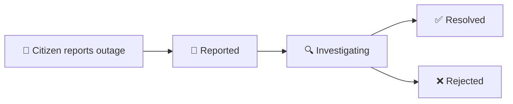

# ⚡ Load Shedding & Power Outage Management System

### Frontend Web App

> Know when the power goes out. Tell us when it already has.
> A fast, clean React app for viewing load-shedding schedules and reporting power outages.

[](https://loadshedding-management.netlify.app/)
[](https://github.com/HaMimFerdowsh/Backend---Load-Shedding-Power-Outage-Management-System)


---

## 🌟 Overview

Power cuts are stressful when you never know when they will happen or how long they will last. This app puts everything in one place:

- 📅 **See** when your area will face load shedding
- 🚨 **Report** an outage the moment it happens
- 🧭 **Follow** your report as it moves from reported to resolved
- 🛠️ **Manage** areas, schedules and reports as an administrator

---

## ✨ Features

### 👤 For Citizens

| | Feature | Description |
|---|---|---|
| 🔐 | **Secure Login** | Sign up and log in with JWT authentication |
| 📍 | **Home Area** | Pick your area during signup from a ready-made list |
| 🗓️ | **Schedules** | Browse load-shedding schedules with search, filters and pagination |
| 🚨 | **Report Outages** | Describe the problem and choose a category |
| 📋 | **My Reports** | View, edit and delete your own reports while they are still pending |

### 🛠️ For Administrators

| | Feature | Description |
|---|---|---|
| 🏙️ | **Area Management** | Organize areas by zone and district |
| ⏱️ | **Schedule Management** | Create and update load-shedding schedules |
| 🔎 | **Outage Review** | Investigate reports and update their status |

### 🎨 For Everyone

- 🔔 Instant toast notifications for every action
- 📱 Fully responsive on phones, tablets and desktops
- ⚡ Lightning-fast loading powered by Vite

---

## 🔄 How an Outage Report Moves



> Citizens can edit or delete a report only while it is still in the **Reported** stage.

---

## 🧰 Tech Stack

| Purpose | Technology |
|---|---|
| ⚛️ UI Library | React 19 |
| ⚡ Build Tool | Vite |
| 🧭 Routing | React Router |
| 🎨 Styling | Tailwind CSS 4 + DaisyUI |
| 🌐 API Requests | Axios |
| 🔑 Token Handling | jwt-decode |
| 🔔 Notifications | React Hot Toast |
| 🖼️ Icons | React Icons |
| 🧹 Linting | Oxlint |
| ☁️ Hosting | Netlify |

---

## 📁 Project Structure

```
.
├── public/             # Static assets
├── src/                # Application source code
├── index.html          # HTML entry point
├── vite.config.js      # Vite configuration
├── package.json        # Dependencies and scripts
└── .oxlintrc.json      # Linting rules
```

---

## 📜 Scripts

| Command | What it does |
|---|---|
| `npm run dev` | Start the development server |
| `npm run build` | Create a production build |
| `npm run preview` | Preview the production build locally |
| `npm run lint` | Check the code with Oxlint |

---

## 🔗 Connected Backend

This app talks to a **FastAPI** backend that handles authentication, areas, schedules and outage reports.

👉 [View the Backend Repository](https://github.com/HaMimFerdowsh/Backend---Load-Shedding-Power-Outage-Management-System)

---

## 🌐 Live Demo

**[loadshedding-management.netlify.app](https://loadshedding-management.netlify.app/)**
